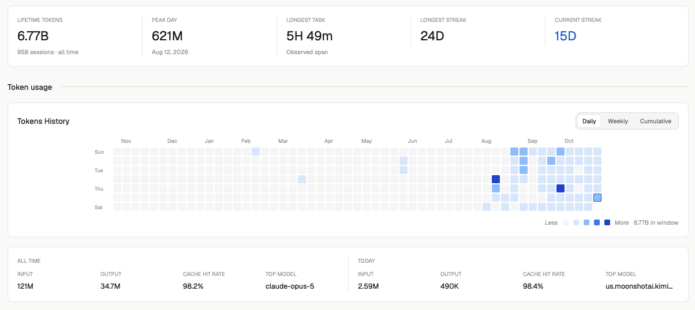
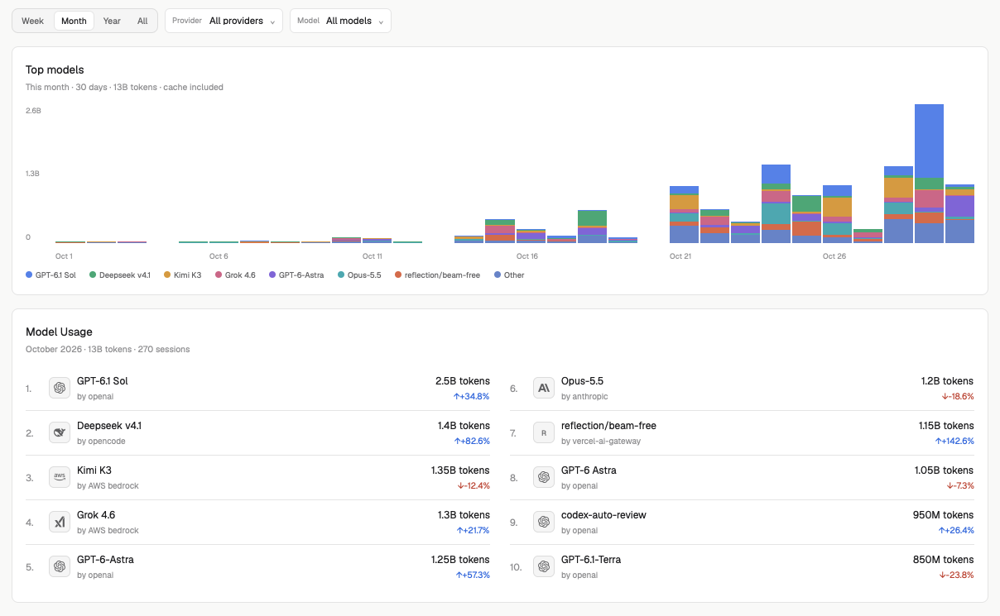

# Insights

A native [Herdr](https://herdr.dev) dashboard for coding-agent token usage.
See which models you use, how usage changes over time, and your daily activity.
Reads local sessions from **Pi, Codex, Claude Code, OpenCode, and Antigravity**.





## Install

Ask your agent:
```
Read https://github.com/harshcurious/usage-insights/blob/main/INSTALL.md and install Insights following it.
```

Or install from a checkout:

```sh
git clone https://github.com/harshcurious/usage-insights.git
cd usage-insights
npm run install:local
```

With Herdr running, the installer checks the `insights` mod and adds an
**Insights** button beside the native tabs; clicking it reuses the current
space's dashboard tab, opening one only when absent. It installs `mods/insights/`
and records ownership in `data/insights/`. Shipped files, tabs, keys, terminals,
and usage data are unchanged. See [INSTALL.md](INSTALL.md) for the layout and
click-state rules. Set `HERDR_APP_HOME` to use a different app home.

## Use

- Compare models and providers with period filters and up/down trends.
- Explore a stacked usage chart, daily heatmap, lifetime totals, and streaks.
- Open **Settings** to choose sources, edit paths, toggle cached tokens, or
  change the palette and refresh interval.

## Privacy

No network requests or uploads. The mod runs a local Node helper, reads session
files and OpenCode/Antigravity SQLite databases, and writes usage metadata to
`~/.config/herdr-app/data/insights/insights.json`. It does not store prompt or
response text or modify source transcripts.

## Development

One native mod, `mods/insights`, provides both views. A pane whose content is
`{mod: "insights", props: {mode: "toolbar"}}` renders only the button; any other
pane shows the dashboard. Toolbar mode starts no Node helper, scans, tasks,
timers, or editors. No layouts or key bindings ship; the button lives in a
personal layout clone composed by the installer, which wraps the native tabs
without modifying them (see [INSTALL.md](INSTALL.md)).

[RECIPE.md](RECIPE.md) is the self-contained rebuild brief required by Herdr.

Tests and package checks run from the repository root (no dependencies):

```sh
npm test        # node --test tests/*.test.mjs
npm run check   # validates mods/insights and the installer
```

## About this fork

Usage Insights is a fork of **Insights** (`herdr-insights`) by
[Gagan Devagiri](https://github.com/GaganSD), from
[GaganSD/coding-agent-toolkit](https://github.com/GaganSD/coding-agent-toolkit/tree/main/herdr-insights),
MIT licensed (see [LICENSE](LICENSE)). It is imported at upstream `522dce2` and
flattened into its own repository. The mod ID stays `insights` and the install
ownership name stays `herdr-insights`, so an existing install upgrades in place.

Changes from upstream:

- Toggling, re-rooting or remapping a source keeps collected history; only the
  files a change invalidates are dropped, and disabled sources are hidden.
- A corrupt store is replaced without losing settings; a store written by a
  newer version is left untouched instead of being reset.
- Locks and worker claims are recognised across hostname changes (macOS
  renames `.local` hosts) by machine ID, so a renamed Mac no longer stays locked.
- Refresh, prepare and save have explicit exec timeouts that cover their work.
- OpenCode reasoning tokens are counted as output (its `tokens.output`
  excludes them); OpenCode databases are read incrementally by `time_updated`,
  including the newer `session_message` schema.
- Token usage and model usage are independent: the heatmap and selected day
  always cover the past year across every model, while the period and
  model/provider filters scope only the model chart and leaderboard;
  leaderboard changes show one sign.
- The model chart follows the period: Week is the last 7 days with one bar
  per day; Month, Year and All show one bar per week, with Month and Year
  weeks clipped to the period.
- Dashboard polling backs off while the background indexer runs.
- Leftover temp/lock files are swept; only three corrupt backups are kept.
- Settings sync can no longer stall; the selected day/year follow today across
  midnight and New Year; a prepare error shows once; unknown
  `insights.period.<x>` commands are ignored; a removed default source stays
  removed.
- Survives Node upgrades: the installer records a stable `node` path (such as
  Homebrew's `bin/node`) and the panel falls back to `node` on PATH when the
  recorded binary is gone.
